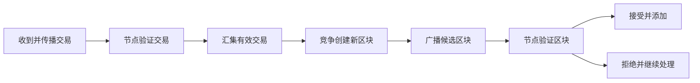

# Step 18: Verifying and Adding Transactions

## 一句话概述：

在开放、没有中央管理者的点对点系统中，节点如何验证交易和区块，并通过工作量证明、奖励、惩罚与对等节点监督，让系统倾向于接受有效数据、拒绝无效数据。

## 主要的技术原理：

**分别验证交易和区块头**。

1. **交易验证**：检查交易格式、含义和授权是否正确。
2. **区块头验证**：检查区块头格式、含义，并验证工作量证明（Proof of Work）。
   有效区块必须包含有效交易，区块头也必须符合规则。PoW 不正确的区块会被拒绝。

**节点交替做两类工作**。

- 收到新区块后，优先验证它。
- 没有新区块待验证时，检查待处理交易、选择有效交易，并尝试创建新区块。
- 节点收到消息后切换工作阶段；系统不依靠“中央时钟”统一指挥。

**竞赛结合速度和质量**

- **速度竞赛**：节点争先解出新区块待哈希谜题；第一个提交有效解的节点成为候选者。
- **质量竞赛**：其他节点检查候选区块中的交易与区块头。
  只有区块通过验证并被接受，提交者才有资格获得奖励。落败节点转而担任检查者。

**奖励和惩罚引导行为**

创建区块需要时间、能源和计算资源，因此奖励、补偿节点的成本，并鼓励节点参与。
无效、重复、过旧或无用的区块可能得不到奖励；先前发放的奖励也可能被撤回。

**每个节点既工作，也监督其他节点**

节点验证交易、尝试创建新区块，也检查其他节点提交的区块。
这样就不需要单一中央监督者；系统依赖节点按共同规则核验。

**发现已接受区块后来无效时，重新处理。**

本节描述的模型会将该区块及后续区块从有效历史中移除，并把其中交易放回待处理队列。
相关奖励会被撤回。如何在竞争分支中选择最终历史，是下一节的主题。

## 处理流程速记

## 关键技术术语

| English                                                      | 中文        | 本节含义               |
| ------------------------------------------------------------ | --------- | ------------------ |
| validation rules /ˌvælɪˈdeɪʃən ruːlz/                        | 验证规则      | 判断交易或区块是否符合要求      |
| inbox /ˈɪnˌbɑːks/                                            | 收件箱、待处理队列 | 节点暂存收到的交易数据        |
| reward /rɪˈwɔːrd/                                            | 奖励        | 补偿创建有效区块的成本并提供参与激励 |
| punishment /ˈpʌnɪʃmənt/                                      | 惩罚        | 例如不给奖励或撤回已发放奖励     |
| peer control /pɪr kənˈtroʊl/                                 | 节点监督      | 节点彼此检查、验证区块        |
| valid block /ˈvælɪd blɑːk/                                   | 有效区块      | 符合规则、通过验证的区块       |
| retrospective validity check /ˌrɛtrəˈspɛktɪv ˈvælɪdəti tʃɛk/ | 事后有效性检查   | 对已处理的交易历史追溯核验      |

## 注意事项

本书用“胡萝卜加大棒”和竞赛来解释节点激励，是为了说明概念的简化模型。不能据此推断所有区块链都采用 PoW、相同的奖励方式或完全相同的区块处理流程。

**比特币白皮书**中的激励要点是：
- 新区块创建者可获得区块奖励与交易费；
- 节点只接受交易有效的区块，并通过继续构建后续区块来表示接受。
